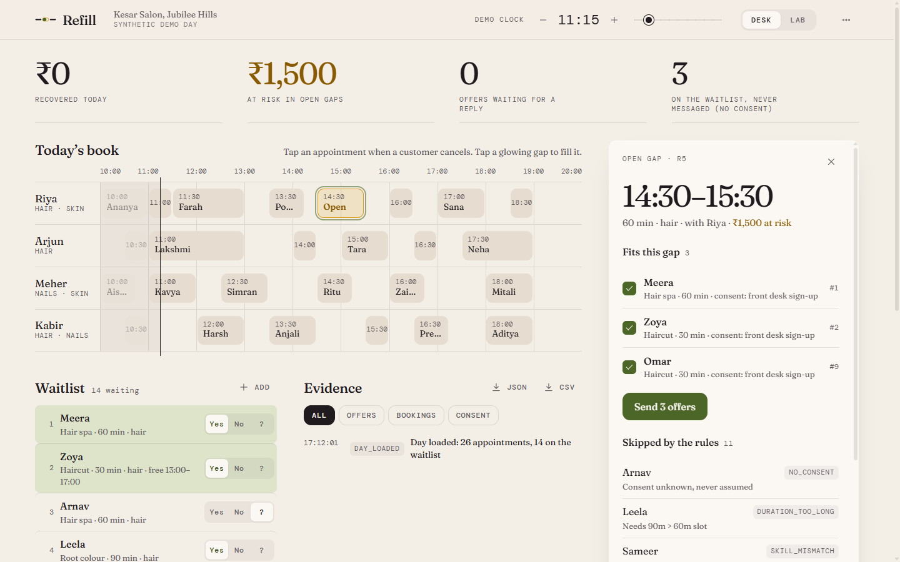
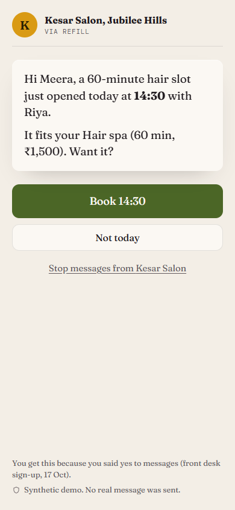
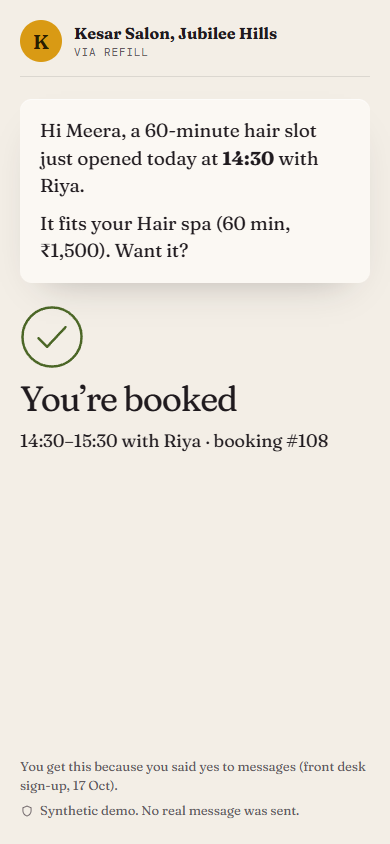

# Refill

**An appointment recovery desk for salons.** When a customer cancels, Refill offers the empty chair to the next waiting customer who fits it, checks consent before every message, and never books two people into one slot.

**Live:** https://fillthechair.vercel.app · install it from the browser menu ("Install app" / "Add to Home Screen").
Built for Fynd × NMIMS Hyderabad, 17–18 October 2026, case **C29 Appointment Recovery Desk**. All data is synthetic.
Guides: [engineering](https://fillthechair.vercel.app/guide/engineering.html) · [business](https://fillthechair.vercel.app/guide/mba.html)



<p> </p>

---

## The journey a judge can repeat

1. Open the live link. You get your own fresh demo day (a salon with 4 stylists, 26 appointments, 14 people on the waitlist).
2. Tap an appointment and choose **Customer cancelled**. The gap opens and starts to glow. A cancellation inside 2 hours is marked late.
3. The panel shows **who fits** the gap and **who is skipped and why**, with a rule code for every skip: `NO_CONSENT`, `SKILL_MISMATCH`, `DURATION_TOO_LONG`, `NOT_AVAILABLE`.
4. Review the list and **send offers**. The database re-checks every rule before any offer exists.
5. The customer opens the offer on a phone (QR code on the desk) and taps **Book**. Two phones tapping at the same moment get one booking and one "you keep your place on the waitlist".
6. Everything lands in the **Evidence** log, exportable as JSON or CSV.

The **Lab** page (`/#/lab`) runs every check live, loads the organiser fixture, lets you change any input, flip an edge case with a before/after export, and fires a real race at the real database.

## The three case checks

| Check | Where it is proven |
|---|---|
| 1. A 60-minute request cannot occupy a 30-minute slot (10) | `src/engine.ts` `reasonFor` → `DURATION_TOO_LONG`; database `fit_reason()` in `send_offers` and again in `accept_offer`; tests C01, C02; Lab check 1 |
| 2. Two requests competing for one slot: one confirmed booking, one waitlist entry (10) | `accept_offer` locks the slot row; a partial unique index allows one confirmed booking per slot; tests C04, C09, C14, C15; `npm run race`; Lab "Run live race"; desk "Two phones, one slot" |
| 3. A customer without contact consent is excluded from outreach (5) | `reasonFor` checks consent first, `null` counts as no; `send_offers` re-checks at the moment of outreach and `accept_offer` again right before booking; STOP revokes open offers; tests C05, C06, C12 |

The organiser fixture (`data/fixture/C29.fixture.json`, kept byte for byte) reproduces its `expected_match` W1 → S2 in `src/engine.test.ts`.

## Edge cases from the card

- **Late cancellation:** notice is measured against the demo clock. Under 2 hours is flagged late; a slot starting within 10 minutes is not offered at all (nobody can get there).
- **Customer withdraws consent:** the consent toggle or the customer's STOP link revokes every open offer at once; a revoked offer cannot be booked.
- **Different service duration:** a shorter service may take a longer slot; a longer one never takes a shorter slot.
- **Staff absence:** v1 can block a slot (`blocked` is never offered). Staff-aware matching is the change our business team negotiates (see "Versions").
- **Bad input:** a duplicate id, a missing field or an invalid value stops the run with `DUPLICATE_ID`, `MISSING_FIELD` or `INVALID_VALUE`. A bad file never produces a half-right answer.
- **Repeated tap:** accepting the same offer twice returns `ALREADY_CONFIRMED` and the same booking.
- **No reply:** every offer holds for 15 demo-minutes (never past the slot's start). After that it lapses, is logged as `OFFER_EXPIRED`, and the next people in the queue are suggested. Accepting a lapsed offer is refused.
- **Nobody is nagged:** at most 3 offers per customer per day (`FREQUENCY_CAP`), enforced by the database.
- **Mistakes:** a cancellation pressed by mistake can be undone while nobody has booked the gap; open offers for it are revoked.

## Run it

Needs Node.js 20 or newer.

```bash
npm install
npm run dev        # http://localhost:5173, talks to the shared demo database
npm test           # rules engine, organiser fixture, every scenario file, demo data
npm run race       # 8 simultaneous taps at the live database, 3 runs
npm run dbtest     # what the public key can and cannot do, limits, holds, caps, undo
npm run build      # production build into dist/
```

No keys to set up: the app uses a publishable key that can only call the database functions (see `src/config.ts`). To use your own Supabase project, apply `supabase/migrations/001_refill.sql` and set `VITE_SUPABASE_URL` / `VITE_SUPABASE_KEY` (see `.env.example`).

## How it is built

```
browser (React, Vite)                              Supabase Postgres
  src/engine.ts   same rules, for previews   ──▶   supabase/migrations/001_refill.sql
  src/api.ts      polls get_state every 1.2s        tables: RLS on, no policies (no direct access)
  src/rpc.ts      POST /rest/v1/rpc/<function>      functions: create_workspace, get_state, cancel_slot,
                                                    send_offers, accept_offer, decline_offer,
                                                    set_consent, stop_messages, add_entry, get_offer
```

- **The database never trusts the page.** Every function re-checks consent, skill, duration and availability.
- **No double booking.** `accept_offer` takes row locks in one fixed order (offer, then slot, then waitlist entry), so simultaneous taps queue instead of deadlocking. The first finds the slot free; the rest find it booked and keep their queue place. A partial unique index (`bookings_one_per_slot`) is the last line of defence.
- **Every visitor gets their own workspace** (a uuid in the URL), so judges never collide. Share the link to open the same day on a phone.
- **Installable** (manifest + service worker). The shell opens offline; bookings are always live.

## Security and abuse limits

Every rule below lives in the database, so it holds even if someone skips the page and calls the API directly. `npm run dbtest` checks each one against the live database.

| Threat | What stops it |
|---|---|
| Reading or writing tables with the public key | Row level security with no policies **and** table privileges revoked from `anon`; the key can only call 13 functions |
| Calling internal functions | `load_day`, `log_event`, `enforce_rate`, `cleanup`, `expire_offers` are not executable by the public key |
| Flooding the database | Per-IP and global limits: 120 new demo days per IP per 10 minutes, 1,500 overall; 240 writes per demo day per minute; 600 taps per IP per minute; 30 taps per offer per minute |
| Oversized or hostile input | Max 300 slots / 300 waitlist entries / 50 offers per call; ids `[A-Za-z0-9_-]{1,32}`; names up to 60 characters, no control characters |
| Storage exhaustion | At most 20,000 demo days; days older than 3 days are deleted |
| Tampering with the evidence | The events table rejects every UPDATE |
| Spreadsheet formula injection | CSV export prefixes cells that start with `= + - @` |
| Script injection | React escapes all text; strict Content-Security-Policy in `vercel.json` |
| Volumetric DDoS | The site is static on Vercel's edge network, which absorbs network-level floods; the database sits behind Supabase's gateway, and the limits above cap what any one client can make it do |

## Data

- `data/fixture/`: the organiser's C29 fixture and readme, unchanged.
- `data/salon/*.csv`: the synthetic demo salon (Kesar Salon, Jubilee Hills): staff, services with INR prices, the day's schedule and the waitlist. The app builds its demo day from these files at build time; the tests fail loudly on a broken reference.

## Versions

- `v1-mba-handover`: the version the MBA team inherited.
- Later tags record each change negotiated with the business team; the thread lives in issues labelled `mba-request`. See `CHANGELOG.md`.

## Team

| | Role |
|---|---|
| Dhruv Sonar ([@sirgreaseball](https://github.com/sirgreaseball)) | Product and full-stack build: rules engine, database functions, app, deployment |
| Vedanth Raj ([@vedanth-raj](https://github.com/vedanth-raj)) | Reliability, handoff check, engineering presentation |
| Parth Kachhara ([@parthkachhara](https://github.com/parthkachhara)) | Test scenarios (`tests/scenarios.json`) |
| Chirag Seervi ([@ChiragSeervi123](https://github.com/ChiragSeervi123)) | Salon data and market-shock scenarios |

Each person's record is in `docs/contributions/`. AI assistants working in this repo must follow `AGENTS.md`.

## Known limits

No owner login: anyone with a workspace link can act on that demo day (the link is an unguessable 122-bit id). Messages are simulated on the offer page; nothing is sent by WhatsApp or SMS. The desk refreshes by polling every 1.2 seconds rather than a live socket. Synthetic data proves the rules, not demand. Full list: `docs/KNOWN_LIMITS.md`.
