<a href="https://fillthechair.vercel.app">
  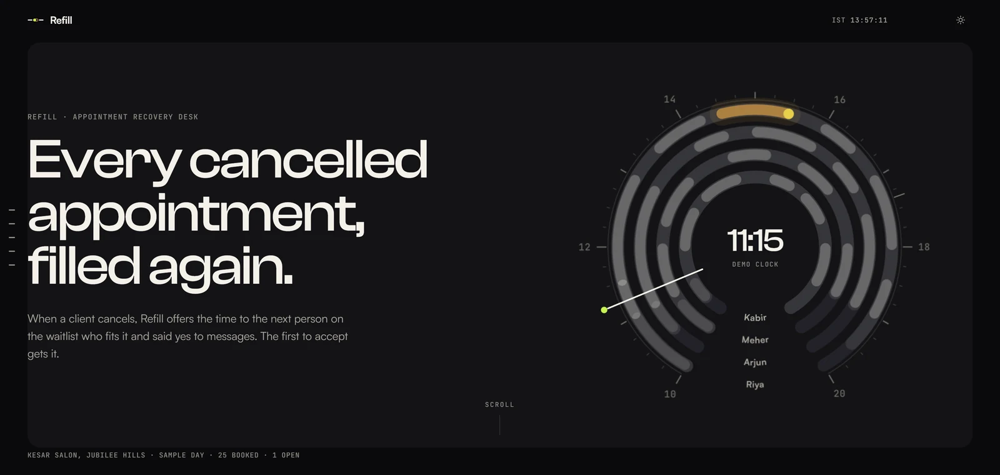
</a>

<br>

<p align="center">
  <b>Refill</b> fills the appointment a client just cancelled.<br>
  It offers the empty slot to the waiting clients who fit it and said yes to messages. The first to accept gets it. Exactly one.
</p>

<p align="center">
  <a href="https://fillthechair.vercel.app"></a>
  &nbsp;
  <a href="https://youtu.be/5BfsKofkIHw"></a>
</p>

<p align="center">
  <sub>Case C29 Appointment Recovery Desk&ensp;·&ensp;Fynd × NMIMS Hyderabad&ensp;·&ensp;51 rule tests&ensp;·&ensp;28 live database checks&ensp;·&ensp;8 taps, 1 booking</sub>
</p>

<br>

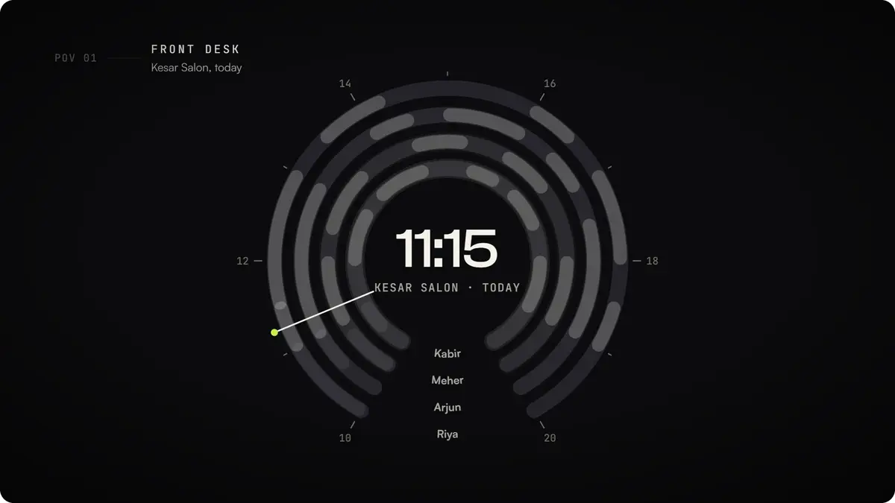

<br>
<br>

### Everything in one place.

| | |
|---|---|
| **Live app** | [fillthechair.vercel.app](https://fillthechair.vercel.app): try the demo salon, or create an account and set up a real business |
| **Story page** | [fillthechair.vercel.app/splash](https://fillthechair.vercel.app/splash): one salon day, told on the Day Dial as you scroll |
| **Product film** | [youtu.be/5BfsKofkIHw](https://youtu.be/5BfsKofkIHw) (3:29, captions and chapters) |
| **Pitch deck** | [Refill-Final-Deck.pdf](docs/team/Refill-Final-Deck.pdf) · [.pptx](docs/team/Refill-Final-Deck.pptx) · light theme: [PDF](docs/team/Refill-Final-Deck-Light.pdf), [.pptx](docs/team/Refill-Final-Deck-Light.pptx) |
| **Citations** | [Refill-Citations.xlsx](docs/submission/Refill-Citations.xlsx): every claim we make, with its source or our test evidence |
| **Credits** | [Refill-Credits-and-Inspirations.pdf](docs/submission/Refill-Credits-and-Inspirations.pdf): what we used, what inspired us, who did what |
| **Engineering** | [B.Tech master document](docs/team/Refill-BTech-Master.pdf) (architecture, database, tests, deployment) |
| **Business** | [MBA master document](docs/team/Refill-MBA-Master.pdf) · [financial projections brief](docs/team/Refill-Financial-Projections-Brief.pdf) |
| **Team guides** | [engineering](https://fillthechair.vercel.app/guide/engineering.html) · [business](https://fillthechair.vercel.app/guide/mba.html) |

<br>

### The problem.

A client cancels an hour before. The chair goes empty and the money walks out the door. Someone on the waitlist would have taken it, but the desk can't tell who fits the slot, who agreed to be messaged, or who gets there first. So the desk starts calling, two people say yes to one slot, and now it is overbooked.

Refill is the recovery desk for that moment. It works for any appointment business: salons first, then clinics, physios, spas and tutoring centres.

<br>

### Who fits, and why not.

The desk sees every waiting client checked against the open slot: consent, the staff member's skills and hours, the service's length, and the client's own free time. Fits are listed in queue order. Every skip shows its reason. One tap sends the offers, and the database checks every rule again before a single one goes out.

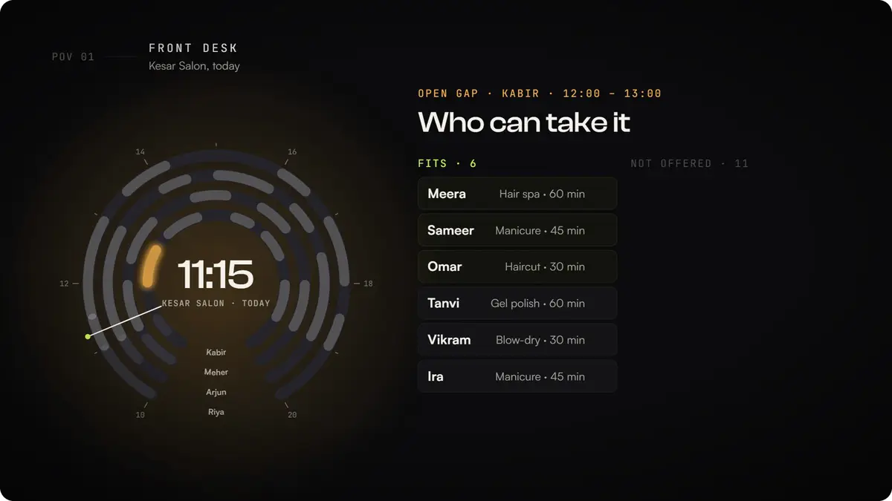

<br>
<br>

### One tap on the client's phone.

The offer arrives as a link. One tap books it. A client who changes their mind about messages taps STOP once, and every open offer is pulled back.

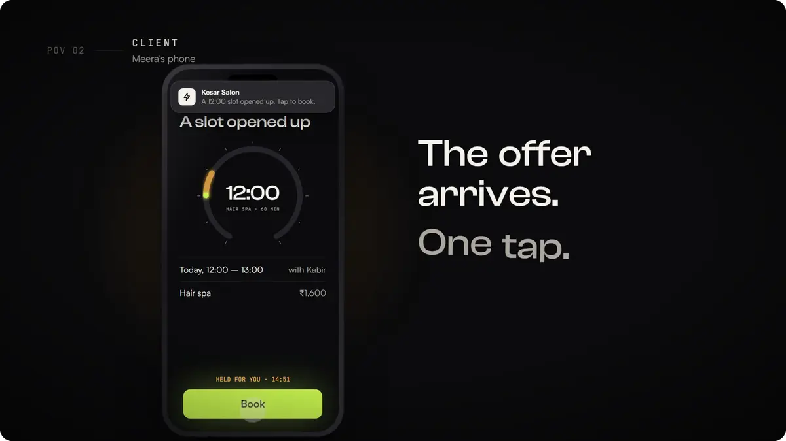

<br>
<br>

### Two phones, one slot.

When two clients tap Book at the same instant, one gets the booking and the other keeps their place on the waitlist. The database decides, under a lock, so it can never put two people in one chair.

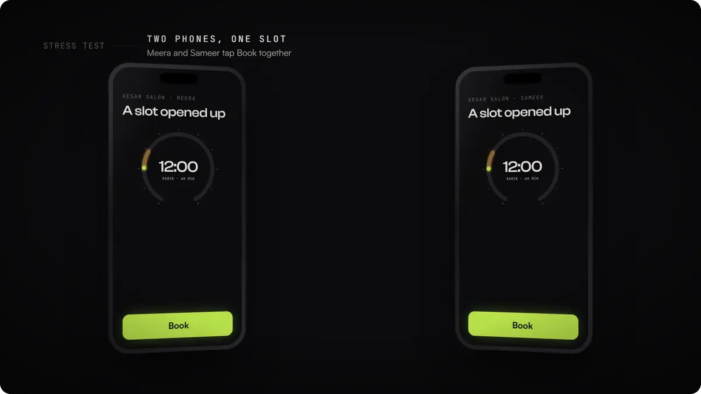

<br>
<br>

### Someone can't come in.

Staff see only their own day. When someone marks themselves out, their offers are withdrawn, their gaps are held and their clients are flagged. Nothing moves until a person decides: the desk picks a new time, or sends the client a link to choose one.

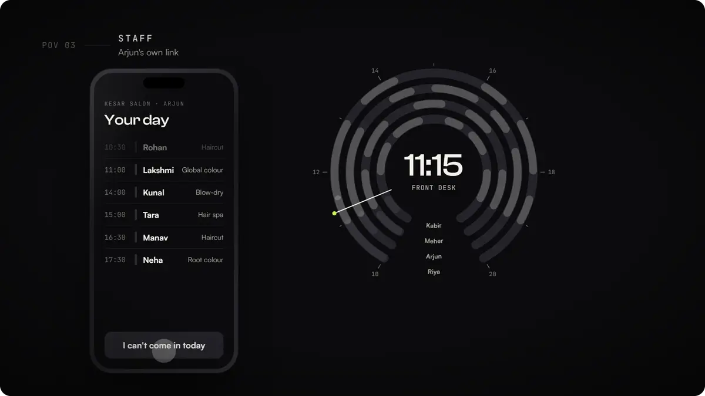

<br>
<br>

### The owner sets the rules.

How long an offer holds, how often anyone can be messaged, what counts as a late cancellation. Offers hold for 15 minutes, then pass to the next in line. Nobody gets more than three a day. Mistakes can be undone. Every step lands in an evidence log that exports as CSV or JSON.

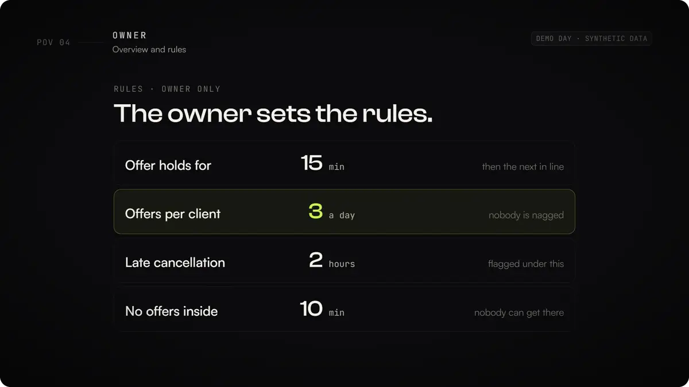

<br>
<br>

### The rules live in the database.

A 60-minute service can never take a 30-minute slot. Consent is checked when offers go out and again at booking. One slot, one booking. The app can only call database functions, so these rules hold even if someone skips the screens and calls the API directly.

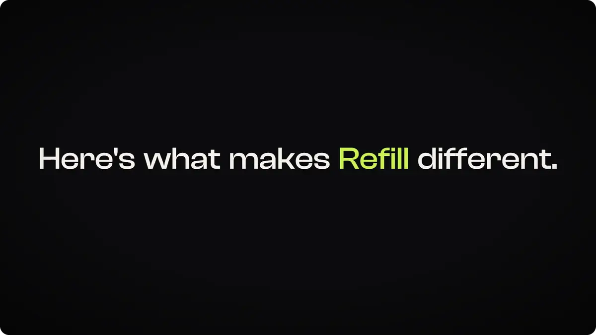

<br>
<br>

### Don't take our word for it.

The Lab (`/#/lab`) runs every case check live in the browser with the same rules engine as the desk, loads the organisers' fixture, lets you change any input or flip an edge case with a before/after export, and fires a real race at the real database.

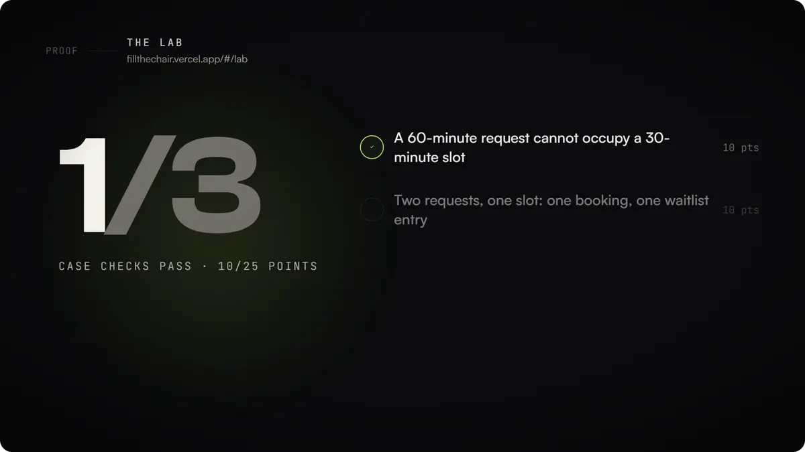

<br>
<br>

### The real app.

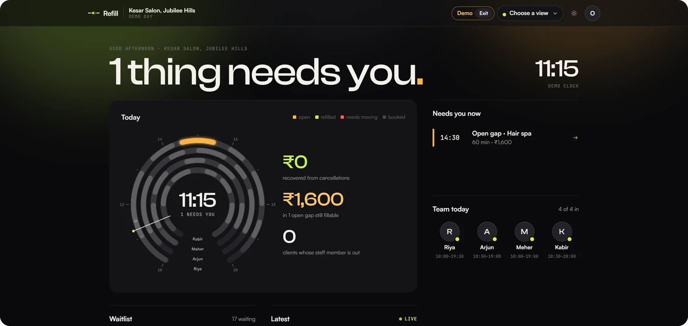

<table>
  <tr>
    <td width="50%">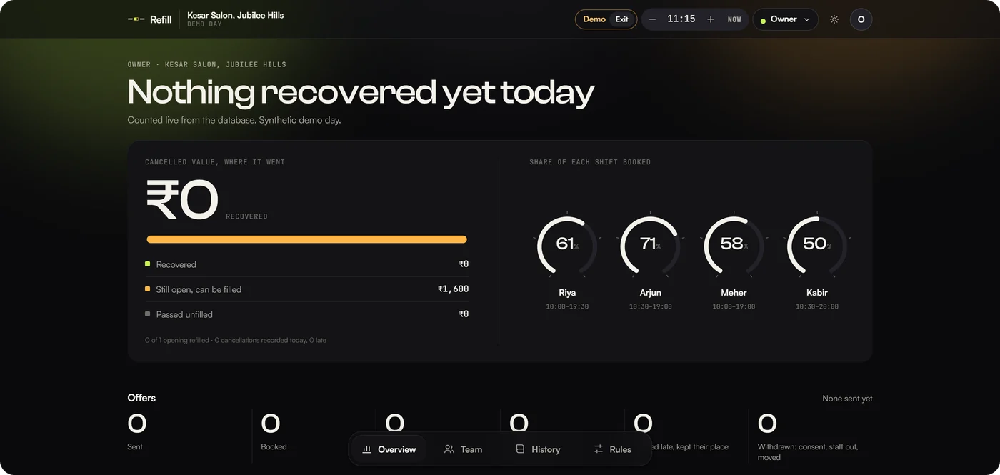</td>
    <td width="50%">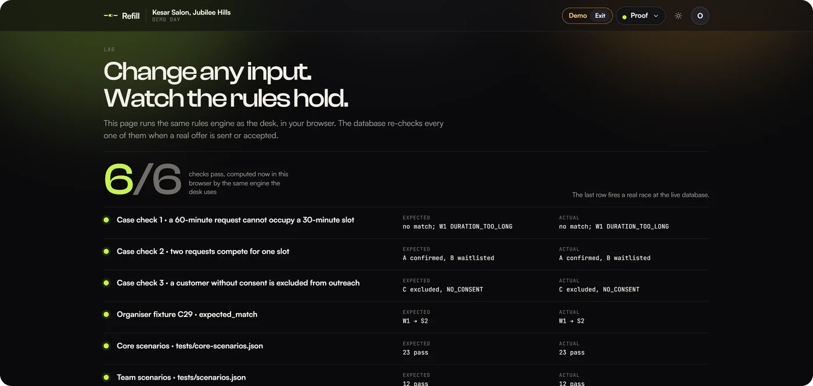</td>
  </tr>
</table>

<br>

## For the judges

### The journey to repeat

1. Open [the live app](https://fillthechair.vercel.app) and choose **Try the demo**. You get your own demo day at Kesar Salon, Jubilee Hills: four stylists, a full book, 17 people waiting, the demo clock at 11:15.
2. On Front desk Today, tap Harsh's 12:00 hair spa with Kabir and record the cancellation. The gap turns amber with ₹1,600 at stake and is flagged late (under 2 hours).
3. **Who fits** lists 6 who fit and 11 who are skipped, each with a reason. Tap **Send 3 offers**.
4. Open an offer on a phone (QR on the desk) and tap **Book**. The slot turns lime and the owner sees ₹1,600 recovered.
5. Mark a stylist out and watch their clients get flagged; move one, or send them a pick-a-time link.
6. Open **Activity** for the evidence log, and **Proof** (`/#/lab`) for the live checks and race.

All of it is synthetic demo data. Nothing here claims real revenue.

### The three case checks

| Check | How Refill guarantees it | Where it is proven |
|---|---|---|
| A 60-minute request cannot occupy a 30-minute slot (10 pts) | The fit check runs in the rules engine and again in the database when offers go out and at booking | Scenario C02, `npm test`, `npm run dbtest`, the Lab |
| Two requests for one slot give one confirmed booking and one waitlist entry (10 pts) | The booking is decided inside the database: row locks in one fixed order, plus a unique index allowing one confirmed booking per slot | Scenarios C04, C09, C13, C14, `npm run race` (8 simultaneous taps, 3 runs) |
| A customer without contact consent is excluded from outreach (5 pts) | Consent is checked first; unknown counts as no; it is checked again at booking; STOP revokes every open offer | Scenarios C05, C06, C12, `npm run dbtest`, the Lab |

The organisers' fixture (`data/fixture/`, kept byte for byte) reproduces its expected match, W1 takes S2, as scenario C01.

### Edge cases and market shocks

- **Late cancellation:** under 2 hours is flagged late; a slot starting within 10 minutes is never offered, because nobody can get there.
- **Staff absence:** that person's offers are withdrawn, their gaps held and their clients flagged; the desk moves them or sends a pick-a-time link.
- **Different service duration:** a shorter service may take a longer slot; a longer one never takes a shorter slot.
- **Customer withdraws consent:** one STOP link revokes every open offer at once; a revoked offer cannot be booked.
- **No reply:** an offer holds 15 minutes (never past the slot's start), then lapses as `OFFER_EXPIRED` and the next in line is suggested.
- **Nobody is nagged:** at most 3 offers per client a day (`FREQUENCY_CAP`), enforced by the database.
- **Repeated tap:** accepting the same offer twice returns the same booking.
- **Bad input:** a duplicate id, a missing field or an invalid value stops the run with `DUPLICATE_ID`, `MISSING_FIELD` or `INVALID_VALUE`, never a half-right answer.
- **Mistakes:** a cancellation pressed by mistake can be undone while nobody has booked the gap.

The click path for each shock is in [`docs/SHOCKS.md`](docs/SHOCKS.md).

### Four roles

| Role | How they get in | What they can do |
|---|---|---|
| Owner | Their account | Overview, team, services, rules, history, settings |
| Front desk | A private desk link | Today, waitlist, activity; cancel, offer, move, add appointments |
| Staff | A private link per person | Their own day; mark themselves out; tick their tasks |
| Client | The booking page or QR, optionally an account | Join a waitlist with a yes or no to messages, book offers, see bookings and past visits |

**Demo or real.** *Try the demo* opens a sample salon on a demo clock, deleted after three days. *Create an account* sets up a real business (name, services, team and hours) on the real clock in India time; each day archives into History at midnight.

### Proof

| Command | What it checks | Result on 18 Oct 2026 |
|---|---|---|
| `npm test` | Rules engine, the organisers' fixture, every scenario file, the demo data | 51 / 51 |
| `npm run dbtest` | What the public key can and cannot do, limits, holds, caps, undo, against the live database | 28 / 28 |
| `npm run flowtest` | Cross-role flows: owner, desk, staff, client | 14 / 14 |
| `npm run race` | 8 simultaneous taps at one live slot, 3 runs | 3 / 3 runs, 1 booking each |

The outside facts behind the deck (market size, cancellation losses, prices, regulation) are each checked against their source in [`Refill-Citations.xlsx`](docs/submission/Refill-Citations.xlsx).

## The business

- **Customer:** owner-operated salons with 3 to 15 staff, Hyderabad first. The owner pays; the front desk uses it every day.
- **Price (hypothesis):** one subscription per location, anchored at ₹699 a month and tested at ₹499, ₹699 and ₹999. At ₹500 contribution per service, about two recovered bookings a month cover it.
- **Next step:** a supervised 30-day pilot on one real calendar, measuring filled cancellations, no-show rate and staff correction effort against a baseline.
- **Honesty rule:** the demo runs on synthetic data and the projections are hypotheses. Only a paid-pilot decision counts as validation.

Full reasoning: [MBA master document](docs/team/Refill-MBA-Master.pdf) and [financial projections brief](docs/team/Refill-Financial-Projections-Brief.pdf).

## Run it

Needs Node.js 20 or newer.

```bash
npm ci             # installs exactly what package-lock.json says
npm run dev        # local app, talks to the shared demo database
npm test           # rules engine, organisers' fixture, every scenario file, demo data
npm run race       # 8 simultaneous taps at the live database, 3 runs
npm run dbtest     # live database guarantees
npm run flowtest   # cross-role flows
npm run build      # production build into dist/
```

No keys to set up: the app uses a publishable key that can only call the database functions (see `src/config.ts`). To use your own Supabase project, apply `supabase/migrations/` in order and set `VITE_SUPABASE_URL` and `VITE_SUPABASE_KEY` (see `.env.example`).

## How it is built

React and TypeScript on Vite, served by Vercel. Supabase Postgres holds every rule: the browser calls database functions over HTTPS and never touches a table. The same rules engine (`src/engine.ts`) runs in the browser for previews and the Lab, and the database re-checks everything that matters.

| Threat | What stops it |
|---|---|
| Reading or writing tables with the public key | Row level security with no policies, and table privileges revoked; the key can only call database functions |
| Double booking | Row locks in one fixed order, and a unique index allowing one confirmed booking per slot |
| Flooding | Rate limits in the database: per IP for new demo days, joins and taps; per workspace for writes; per offer for taps |
| Storage exhaustion | Demo days are deleted after three days |
| Tampering with the evidence | The events table rejects every update |
| Spreadsheet formula injection | CSV export neutralises cells that start with `= + - @` |
| Script injection | React escapes all text; a strict Content-Security-Policy in `vercel.json` |

## Beyond salons

Nothing in the rules engine or the database knows it is a salon. It knows providers with skills and working hours, services with durations and prices, appointments, a waitlist with consent, and four roles. A clinic, physio, spa or tutor is a different set of services and a different set of words on screen; the matching, the no-double-booking guarantee, consent, moves and roles stay the same.

## Known limits

Offers are links and QR codes; nothing is sent by SMS or WhatsApp yet (that needs DLT registration and approved templates). There is no calendar sync with other booking apps, and no booking of future dates. The desk refreshes by polling every two seconds rather than a live socket. Sign-in is email and password only. Synthetic data proves the rules, not demand.

## Team

| | Team | Role |
|---|---|---|
| **Vedanth Raj** ([@vedanth-raj](https://github.com/vedanth-raj)) | B.Tech · team lead | Reliability, clean-machine setup check, known limits, demo script, engineering presentation |
| **Dhruv Sonar** ([@sirgreaseball](https://github.com/sirgreaseball)) | B.Tech | Product and code: rules engine, database, every screen, design system, deployment, film |
| **Parth Kachhara** ([@parthkachhara](https://github.com/parthkachhara)) | B.Tech | Scenario tests, real-phone testing and bug reports, Lab fixes |
| **Chirag Seervi** ([@ChiragSeervi123](https://github.com/ChiragSeervi123)) | B.Tech | Salon data and prices, market-shock scenarios, the story page |
| **Parth Srivastava** | MBA | Market research, positioning, pricing, unit economics, projections, go-to-market |
| **Tushar Walia** | MBA | Market research, positioning, pricing, unit economics, projections, go-to-market |

Each engineer's record is in [`docs/contributions/`](docs/contributions). Everything we used or learned from is credited in [Credits and inspirations](docs/submission/Refill-Credits-and-Inspirations.pdf).

<br>

<p align="center">
  <a href="https://fillthechair.vercel.app">
    <picture>
      <source media="(prefers-color-scheme: dark)" srcset=".github/media/mark-dark.svg">
      
    </picture>
  </a>
  <br><br>
  <sub>React · TypeScript · Supabase Postgres · Vercel</sub>
  <br>
  <sub>MIT licensed · © 2026 Dhruv Sonar and the Refill team</sub>
</p>
